# 2. Bản đồ

Bản đồ được **sinh bằng code** từ một seed: `tools/mapgen/`. Mọi hình trong chương này là ảnh render thật từ bộ sinh đó (seed `20261111`), không phải tranh vẽ minh họa. Chạy lại:

```bash
node tools/mapgen/render.mjs [seed]     # ~4 giây, ghi ảnh vào docs/design/assets/map/
```

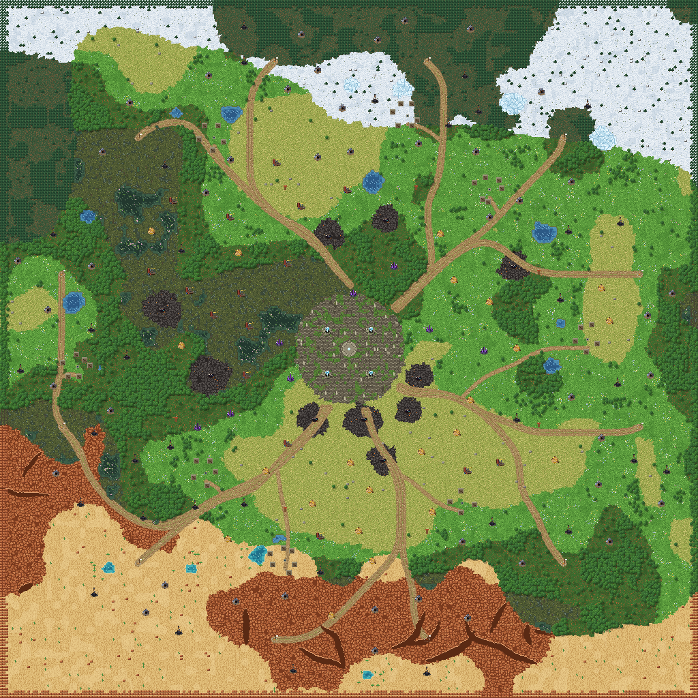

*Toàn bản đồ, 4 px mỗi ô. Bắc lạnh (đồng tuyết, rừng thông), Nam nóng (sa mạc, hoang mạc đá đỏ), giữa là đồng cỏ, rừng lá rộng, đầm lầy. Tâm bản đồ là cao nguyên cổ với 4 mỏ Kim cương. 12 con đường từ 12 điểm xuất phát dẫn vào tâm.*

## 2.1 Kích thước và hệ tọa độ

| | |
|---|---|
| Lưới | **256 × 256 ô**, mỗi ô **16 × 16 px**. Toàn bản đồ là 4096 × 4096 px ở mức phóng ×1 |
| Tọa độ | `(x, y)` tính bằng ô, có phần thập phân. `(0, 0)` ở góc trên bên trái, `y` tăng khi đi xuống. Quân đi liên tục, ô chỉ dùng cho địa hình, vật cản và tìm đường |
| Thời gian băng qua | Nhân vật (2,4 ô/giây) đi từ mép vào tâm theo đường lớn mất khoảng **50 giây**, băng hết chiều ngang khoảng **110 giây** |
| Mép bản đồ | Dải **cây rừng, thông, đá tảng** dày 2–3 ô (tùy vùng), không đi qua được. Không có tường nhân tạo |
| Đi được | Khoảng **80%** số ô. Còn lại là cây, đá, nước, khe nứt, nhà, mỏ |

## 2.2 Giống và khác Ant War

| | Ant War | Sodier War |
|---|---|---|
| Lưới | 192 × 192 ô | **256 × 256 ô** |
| Sinh địa hình | Ba trường nhiễu (độ cao, độ ẩm, nhiệt độ) chia vùng đất | Hai trường **nhiệt độ** (lạnh ở Bắc, nóng ở Nam, cộng nhiễu) và **độ ẩm**. Chia vùng theo thứ hạng nên tỉ lệ vùng gần như không đổi với mọi seed |
| Kết cấu đất | Mỗi pixel một màu, tính từ (x, y) nên ghép liền mạch | **Giữ nguyên cách làm này**: 10 loại đất có hoa văn riêng (mục 2.4) |
| Rừng | Tán cây tròn san sát | Như vậy, thêm rừng thông có tuyết và lùm cây giữa đồng cỏ |
| Sông, suối, núi, vách đá, biển | Có | **Không có** |
| Nước | Sông, biển, ao | Chỉ có **ao nhỏ, vũng lầy, ốc đảo** và **hồ băng** (đi được). Không có dòng nước chảy dài |
| Chướng ngại tự nhiên | Núi, vách | **Khe nứt** ở hoang mạc đá đỏ, chỗ thắt nút tự nhiên |
| Công trình | Tổ kiến | **Làng hoang, tháp canh, phế tích cổ, đường đất** |

## 2.3 Mười vùng đất

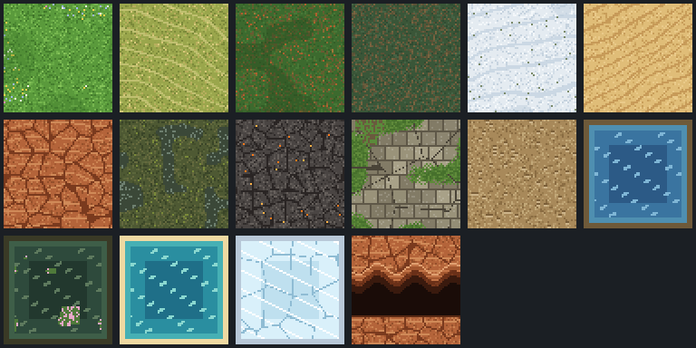

*Hàng 1: Đồng cỏ, Thảo nguyên khô, Rừng lá rộng, Rừng thông, Đồng tuyết, Sa mạc. Hàng 2: Hoang mạc đá đỏ, Đầm lầy, Vùng tro cháy, Cao nguyên cổ, Đường đất, Ao. Hàng 3: Vũng lầy, Ốc đảo, Hồ băng, Khe nứt.*

| Vùng | Tỉ lệ | Tốc độ đi | Nằm ở đâu | Kết cấu đất (pixel art) | Vật cản | Trang trí (không chặn) | Mỏ hay gặp |
|---|---|---|---|---|---|---|---|
| **Đồng cỏ** | 23% | 1,00 | Vành giữa, ôn hòa | Cỏ xanh 5 sắc, lá cỏ lẻ, **thảm hoa** trắng/vàng/hồng/lam, mảng cỏ đậm | **Lùm cây** (cụm 4–15 cây), cây lẻ, ao nhỏ | Bụi cỏ, bụi cây có quả, khóm hoa, đá cuội | Sắt, Than |
| **Thảo nguyên khô** | 14% | 1,00 | Rìa khô của đồng cỏ | Cỏ vàng xanh, **vệt gió** chạy chéo, bông cỏ khô | Tảng đá, cây lẻ | Bụi cỏ khô | Sắt, Vàng, Dầu |
| **Rừng lá rộng** | 15% | 0,85 | Vùng ẩm | Nền rêu đậm, **lá rụng** nâu đỏ, bóng tán | **Tán cây dày** (~50% ô), có trảng trống, có cây ra hoa/quả | Nấm đỏ, gốc cây, bụi | Than, Pha lê |
| **Rừng thông** | 8% | 0,85 | Phía Bắc, ẩm | Nền xanh xám, **lá kim** nâu | Thông cao 3–4 tầng, dày | Gốc cây, đá | Than, Pha lê |
| **Đồng tuyết** | 8% | 0,85 | Phía Bắc, khô | Tuyết trắng xanh, **gợn tuyết** theo gió, cỏ khô lộ ra | Thông phủ tuyết thưa, đá phủ tuyết | Bụi cỏ khô | Sắt, Than, Pha lê |
| **Sa mạc** | 12% | 0,90 | Phía Nam, khô | Cát vàng, **gợn cát**, vùng cát sáng | Xương rồng (có hoa), đá đỏ | Xương thú, đá | Vàng, Dầu |
| **Hoang mạc đá đỏ** | 8% | 0,90 | Phía Nam, ít khô hơn | Đất đỏ cam **nứt nẻ**, vân đá phân tầng | Cụm đá đỏ, **khe nứt** | Đá đỏ nhỏ, xương | Vàng, Dầu đen, Sắt |
| **Đầm lầy** | 7% | 0,75 | Vùng ẩm nhất | Bùn xanh xám, vũng nước đọng có ánh | **Vũng lầy** lớn có bèo và hoa súng, cây chết | Lau sậy, nấm | Dầu, Dầu đen, Pha lê |
| **Vùng tro cháy** | 2% | 0,90 | Quanh mỗi hố Dầu đen (bán kính 4–7 ô) | Tro xám đen nứt, **than hồng** lấp lánh | Cây cháy đen | Xương, đá | Dầu đen |
| **Cao nguyên cổ** | 2% | 1,00 | Tâm bản đồ, bán kính 20 ô | **Đá lát cổ** so le, kẽ vữa, rêu phủ từng mảng, vết nứt dài, chỗ mất đá lộ đất và cỏ | Vòng cột đá, tường đổ, cột gãy | Gạch vụn | **Kim cương** (4 mỏ) |

- **Ranh giới giữa hai vùng** không thẳng theo ô: mỗi pixel lấy vùng của ô ở vị trí lệch theo hai lớp nhiễu (lớn và nhỏ), nên mép vùng lượn tự nhiên, có răng cưa nhỏ.
- Tốc độ đi của đội lấy theo ô dưới chân nhân vật chính.

## 2.4 Địa hình đặc biệt

| Địa hình | Số lượng (seed mẫu) | Đi qua? | Mô tả | Ý nghĩa chiến thuật |
|---|---|---|---|---|
| **Đường đất** | 12 đường chính + 8 đường nhánh vào làng | ✅ tốc độ **1,15** | Rộng 2,5 ô (đường nhánh 1,5 ô). Lượn mềm (đường A* được làm trơn), có **hai vệt bánh xe**, dải cỏ giữa đường, mép bụi đất. Đường tự xóa cây/đá trên lối đi | Đi nhanh từ nhà vào tâm. Dễ đoán đường địch tới |
| **Ao** (đồng cỏ, rừng) | 11 | ❌ | Nước 3 tầng sâu, sóng sáng, bờ bùn, lau sậy quanh bờ | Che sườn khi đánh |
| **Vũng lầy** | ~8% diện tích đầm lầy | ❌ | Nước đục xanh rêu, bèo, hoa súng hồng | Đầm lầy thành mê cung, đội lớn khó đi |
| **Ốc đảo** | 4 | ❌ | Nước xanh ngọc, bờ cát sáng, **6 cây cọ** quanh | Mốc định hướng giữa sa mạc |
| **Hồ băng** | 5 | ✅ tốc độ **0,70** | Băng xanh nhạt, vết nứt, vệt sáng chéo | Đường tắt chậm |
| **Khe nứt** | 14 | ❌ (quân bay qua được) | Rộng 1–2,5 ô, **thon ở hai đầu**, dài 12–30 ô. Mép trên sáng, vách đỏ phân tầng, đáy tối dần | **Chỗ thắt nút**: ép đội lớn vòng đường, nơi tốt để phục kích |
| **Làng hoang** | 8 | Nhà ❌ | 4–6 nhà đá đổ (mái ngói đỏ, mái rơm hoặc mái đá đen, mái thủng lộ xà), giếng ở giữa, hàng rào, đống rơm, thùng gỗ, xe kéo, luống rau. Có đường nhánh nối ra đường lớn và biển chỉ đường | **Giếng làng:** nhân vật đứng cạnh giếng (≤ 2 ô) khi không giao chiến thì hồi máu ×3. Nhà làm chỗ nấp |
| **Tháp canh** | 8 (7 đặt được ở seed mẫu) | ❌ | Tháp gỗ 4 chân, sàn có lan can, mái ngói đỏ, cờ rách | Nhân vật đứng cạnh tháp (≤ 2 ô) thì **tầm nhìn 30 ô** thay vì 18 |
| **Phế tích cổ** | Vòng 12 cột ở bán kính 18, vòng 8 cột ở bán kính 6, cột gãy và tường đổ rải rác | ❌ | Cột đá có rãnh dọc, rêu leo, cột gãy | Che chắn quanh mỏ Kim cương. Bốn khe hở để bốn đường lớn đi vào |
| **Quảng trường đá** | 1, ở tâm | ✅ | Vòng tròn 6 ô, đá lát hình nan quạt, **ký tự cổ phát sáng lam**, viên đá sáng ở giữa | Nơi gặp nhau của 12 đường. Trận lớn nhất game thường ở đây |

## 2.5 Vùng theo khoảng cách tới tâm

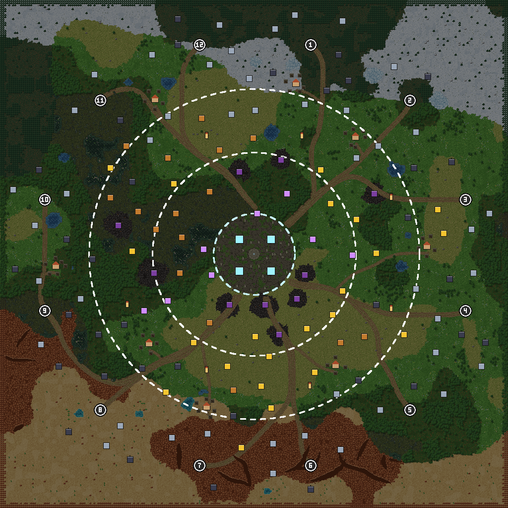

*Vòng nét đứt: lõi (r = 0,16), vùng trong (r = 0,40), vùng ngoài (r = 0,65). Ô vuông là mỏ theo màu tài nguyên. Số trong vòng tròn là điểm xuất phát. Nhà mái đỏ là làng, cột vàng là tháp canh.*

Gọi `r` là khoảng cách tới tâm chia cho 128 ô.

| Vùng | r | Có gì |
|---|---|---|
| **Vùng ngoài** | > 0,65 | 12 điểm xuất phát, Sắt và Than. Làng hoang ở mép trong. Tương đối an toàn |
| **Vùng giữa** | 0,40 – 0,65 | Vàng, Dầu, ít Dầu đen. Tháp canh. Nơi các đội hay chạm nhau lần đầu |
| **Vùng trong** | 0,16 – 0,40 | Dầu đen (có vùng tro), Pha lê, Dầu. Lính canh mạnh |
| **Lõi** | < 0,16 | Cao nguyên cổ, 4 mỏ Kim cương quanh quảng trường. Golem kim cương canh |

## 2.6 Mỏ trên bản đồ

| Mỏ | Số mỏ | Vùng (r) | Vùng đất ưu tiên | Ghi chú |
|---|---|---|---|---|
| Sắt | 44 | 0,55 – 1,0 | Đồng cỏ, Thảo nguyên, Đá đỏ, Đồng tuyết | 24 mỏ là mỏ khởi đầu (mục 2.7) |
| Than | 34 | 0,50 – 1,0 | Rừng lá rộng, Rừng thông, Đồng cỏ, Đồng tuyết | 12 mỏ là mỏ khởi đầu |
| Vàng | 22 | 0,32 – 0,80 | Sa mạc, Đá đỏ, Thảo nguyên | |
| Dầu | 16 | 0,28 – 0,68 | Sa mạc, Đầm lầy, Thảo nguyên | |
| Dầu đen | 10 | 0,20 – 0,55 | Đầm lầy, Đá đỏ, Thảo nguyên | Mỗi hố tự sinh vùng tro cháy quanh nó |
| Pha lê | 8 | 0,16 – 0,50 | Rừng lá rộng, Rừng thông, Đầm lầy, Đồng tuyết | |
| Kim cương | 4 | Lõi, cách tâm 12 ô theo 4 hướng chéo | Cao nguyên cổ | |
| **Tổng** | **138** | | | Khoảng 11–14 mỏ cho mỗi người khi đủ 10 người |

- Mỏ ngoài vùng ưu tiên vẫn có thể xuất hiện, nhưng hiếm (xác suất 12%).
- Hai mỏ cách nhau **ít nhất 12 ô**, mỏ cách điểm xuất phát ít nhất 11 ô (trừ mỏ khởi đầu).
- Quanh mỗi mỏ có **vùng sạch bán kính 4 ô** để có chỗ đánh nhau. Mô hình mỏ chặn ô dưới nó (3×3, Kim cương 4×4).

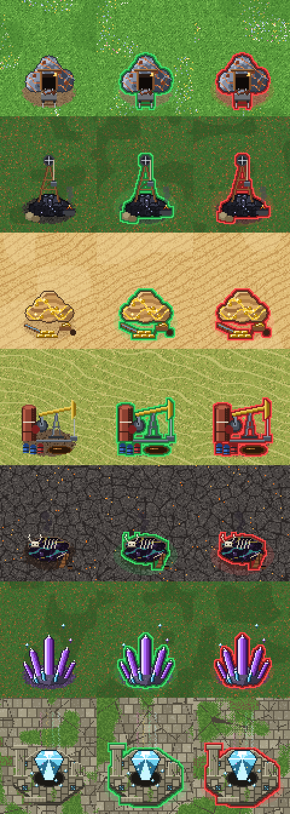

*Bảy mỏ ở ba trạng thái: trống, của mình (viền xanh), của người khác (viền đỏ). Viền chỉ bám thân mô hình, không bám khói, tia sáng hay mảnh pha lê bay. Chi tiết từng mô hình ở [11-mo-hinh-mo.md](11-mo-hinh-mo.md).*

## 2.7 Điểm xuất phát

- **12 điểm** trên vòng r = 0,86, cách nhau 30°, lệch 15° khỏi các trục để không nằm thẳng hàng với đường vào tâm của nhau.
- Mỗi điểm là một **trại**: vòng 10 hòn đá, đống lửa trại, cột cờ trắng. Quanh trại sạch vật cản bán kính 6 ô.
- Mỗi điểm có **2 mỏ Sắt và 1 mỏ Than** trong vòng 12–20 ô, và một **đường đất** dẫn thẳng vào tâm.
- Vào game: server chọn điểm **xa nhân vật đang sống gần nhất**. Khiên bảo vệ 60 giây như trước.

## 2.8 Ảnh cận cảnh (đúng tỉ lệ trong game, ×2)

Mỗi ảnh là một khung 40 × 24 ô, đúng 16 px mỗi ô, phóng ×2 để xem. Mỏ được gán ngẫu nhiên trống / của mình / của người khác để thấy viền.

**Khu xuất phát.** Trại có cột cờ, đường đất, mỏ Sắt viền xanh, lùm cây giữa đồng cỏ, mép rừng.
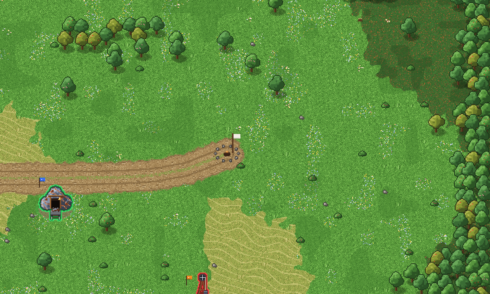

**Cao nguyên cổ.** Quảng trường ký tự lam, vòng cột, 4 mỏ Kim cương, đá lát phủ rêu.
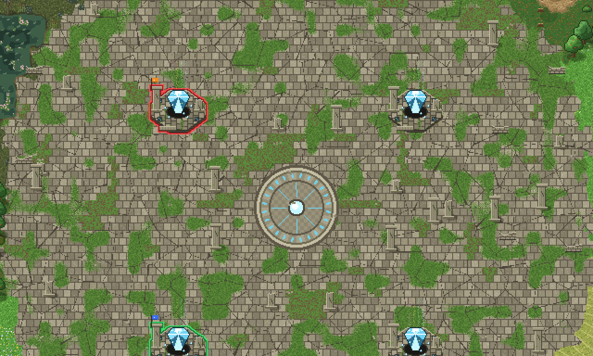

**Làng hoang.** Nhà mái thủng, giếng, hàng rào, đống rơm, xe kéo, luống rau, đường nhánh có biển chỉ đường.
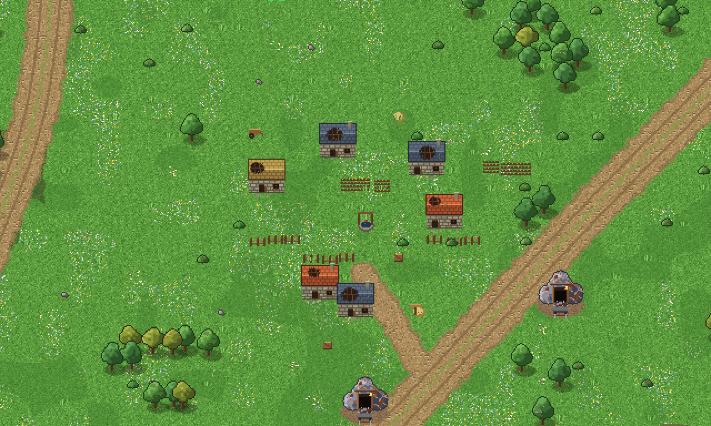

**Hoang mạc đá đỏ.** Đất nứt nẻ, khe nứt thon hai đầu, đường lượn có vệt bánh xe, mỏ Vàng và Sắt.
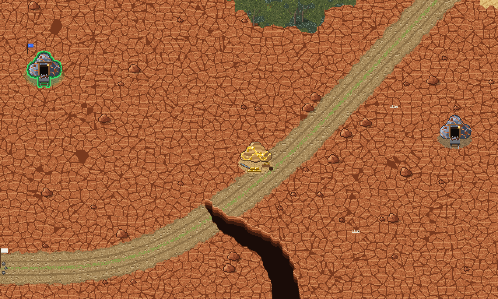

**Hố dầu đen.** Vùng tro cháy giữa đầm lầy, vũng lầy có hoa súng, giếng Dầu của người khác.
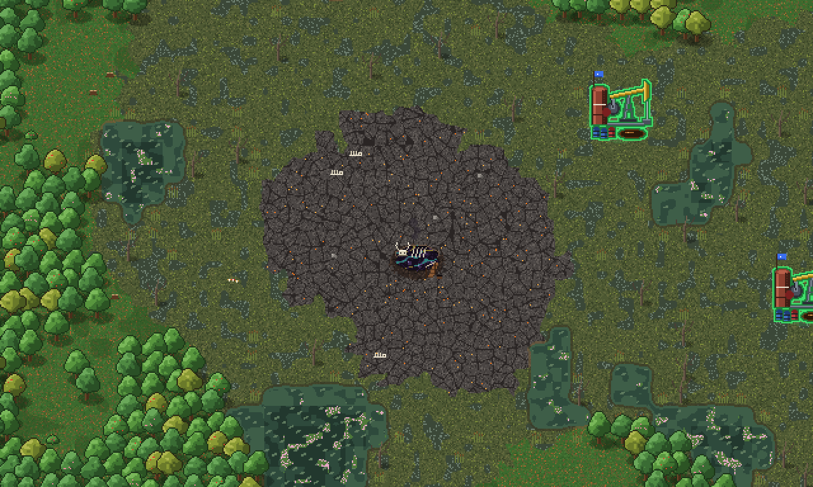

**Sa mạc và ốc đảo.**
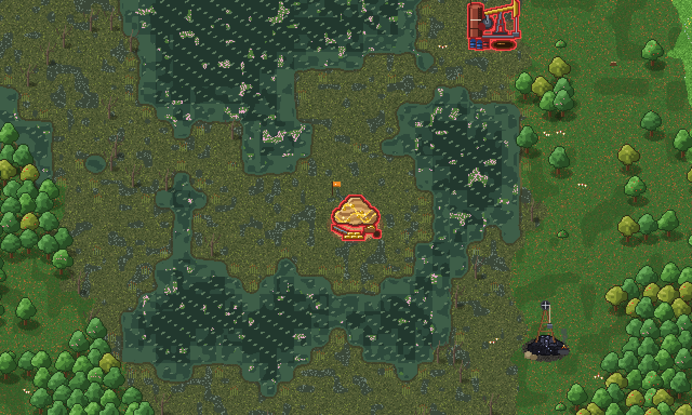

**Rừng và mỏ Pha lê.**
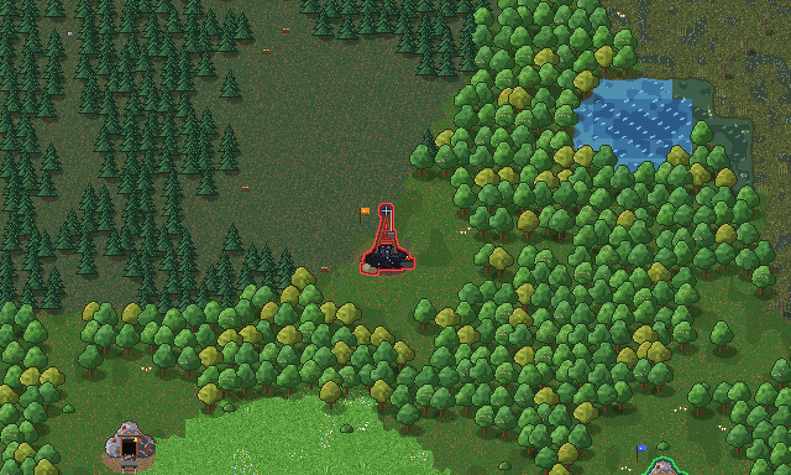

**Đồng tuyết.** Thông phủ tuyết, hồ băng, đá phủ tuyết, làng ở mép rừng thông.
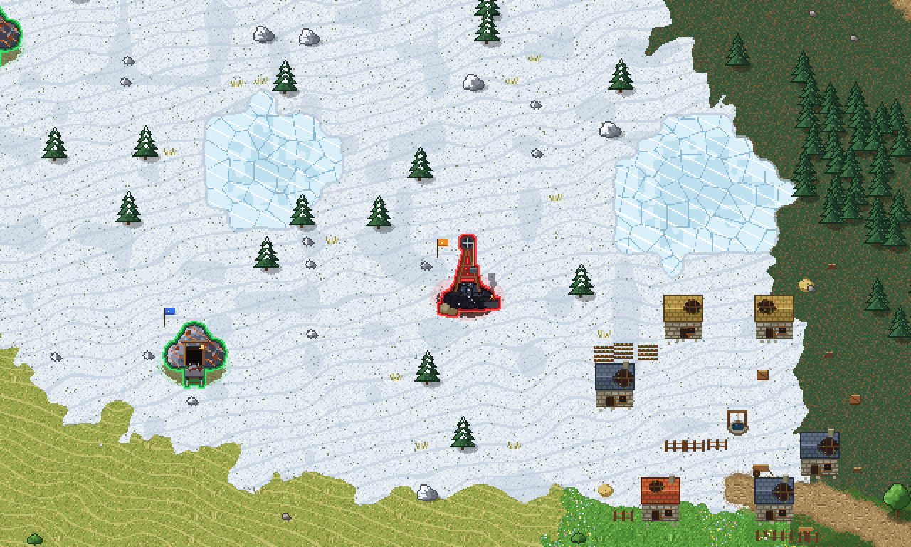

## 2.9 Minimap

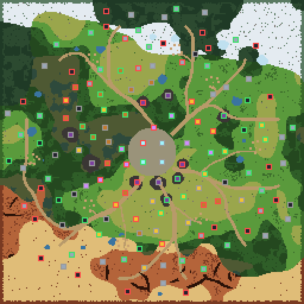

Minimap trong game vẽ 1 px mỗi ô (256 × 256, HUD hiện ở 180–256 px). Mỏ là ô 3 × 3 màu tài nguyên trong khung xanh (của mình), đỏ (người khác) hoặc xám (trống).

## 2.10 Thuật toán sinh (tóm tắt `tools/mapgen/gen.mjs`)

1. **Khí hậu:** `nhiệt = 0,58 × (y / H) + 0,42 × nhiễu`, `ẩm = nhiễu`. Nhiễu fbm 3 tầng.
2. **Vùng đất theo thứ hạng:**
   - 17% lạnh nhất chia đôi theo độ ẩm thành Rừng thông / Đồng tuyết.
   - 21% nóng nhất thành Sa mạc (60% khô hơn) / Hoang mạc đá đỏ.
   - Phần giữa: 13% ẩm nhất thành Đầm lầy, 25% kế tiếp thành Rừng lá rộng, 24% khô nhất thành Thảo nguyên, còn lại là Đồng cỏ.
   - r < 0,16 luôn là Cao nguyên cổ.
3. **Điểm xuất phát** và **mỏ khởi đầu**, rồi 4 mỏ Kim cương, rồi các mỏ còn lại theo vùng r, vùng đất ưu tiên và khoảng cách tối thiểu.
4. **Vùng tro** quanh hố Dầu đen.
5. **Nước:** ao, ốc đảo, hồ băng, vũng lầy (ngưỡng nhiễu trong đầm lầy).
6. **Khe nứt:** bước ngẫu nhiên có quán tính trong hoang mạc đá đỏ, lưu thành đường cong, độ rộng thon theo `sin`.
7. **Cây, đá, xương rồng** theo mật độ từng vùng (rừng dùng nhiễu cụm nên có trảng trống).
8. **Phế tích** ở lõi, **làng** (vùng giữa, cách nhau ≥ 40 ô), **tháp canh** (8 hướng, r ≈ 0,5).
9. Dọn sạch quanh mỏ, trại, làng. Đóng dấu ô mỏ. Dựng **mép bản đồ** bằng cây/đá.
10. **Đường:** A* từ mỗi trại vào lõi. Chi phí rẻ hơn trên đường đã có, nên các đường nhập lại với nhau. Rồi đường nhánh từ làng ra đường gần nhất. Đường được làm trơn (trung bình trượt) rồi đóng dấu ô theo độ rộng.
11. **Kiểm tra liên thông:** loang từ tâm. Ô trống nào không tới được thì đục lối qua vật cản gần nhất (seed mẫu đục 137 ô).
12. **Trang trí** không chặn theo vùng (hoa, cỏ, nấm, lau sậy, xương, gạch vụn) và đồ đạc quanh làng.

Khi làm game (cột mốc M0), `gen.mjs` được chuyển thành `packages/sim/src/map.ts` dùng chung cho server và client. Phần vẽ (`art.mjs`, `render.mjs`) thành bộ vẽ ô đất của client.
