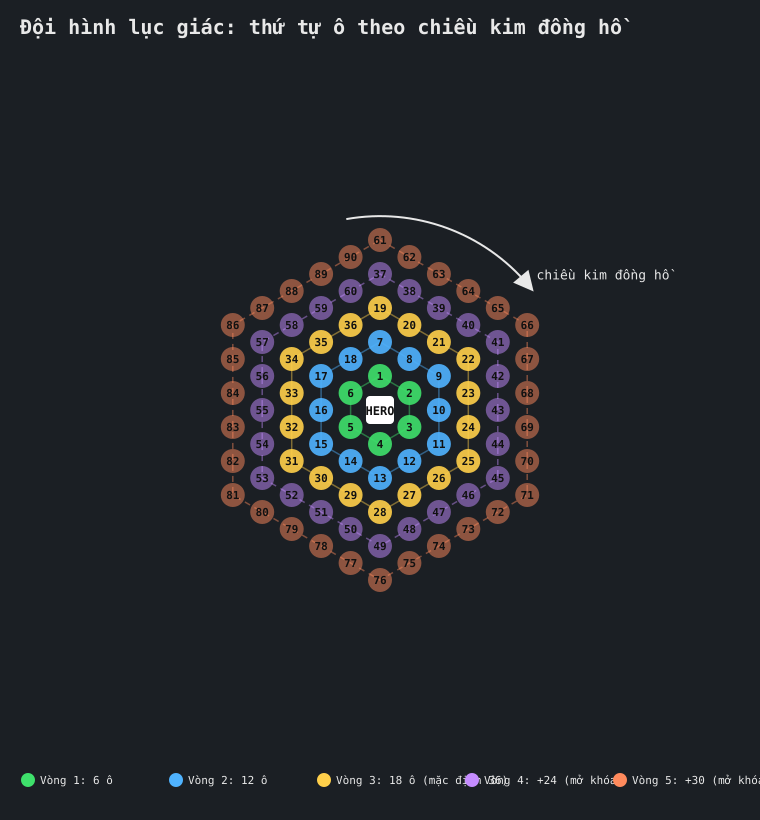

# 7. Đội hình lục giác



## 7.1 Nguyên tắc

- Mua một quân xong, quân đó **tự đứng vào ô trống kế tiếp** của khối lục giác quanh nhân vật chính.
- Các ô xếp theo **vòng**: vòng 1 sát nhân vật, rồi vòng 2, vòng 3...
- Trong mỗi vòng, ô đầu tiên ở **đỉnh trên cùng** (hướng Bắc, ngay phía trên nhân vật). Các ô sau đi **theo chiều kim đồng hồ** (lên → phải → xuống → trái → lên).
- Khối lục giác **không xoay** theo hướng đi. Đỉnh trên luôn chỉ lên phía trên màn hình. Người chơi luôn đoán được quân nào đứng ở đâu.

## 7.2 Số ô

| Vòng | Số ô của vòng | Tổng ô tới vòng này | Bán kính (ô bản đồ) | Mở khóa |
|---|---|---|---|---|
| 1 | 6 | 6 | 1,5 | Có sẵn |
| 2 | 12 | 18 | 3,0 | Có sẵn |
| 3 | 18 | 36 | 4,5 | Có sẵn |
| 4 | 24 | 60 | 6,0 | 200 Vàng |
| 5 | 30 | 90 | 7,5 | 350 Vàng + 30 Pha lê |

Vòng k có **6k ô**. Tổng tới vòng n là **3n(n+1)**.

## 7.3 Công thức tọa độ

Đặt `d = 1,5 ô` (khoảng cách giữa hai ô cạnh nhau). Lục giác có đỉnh nhọn hướng lên. Hệ tọa độ màn hình có `y` hướng xuống, nên góc tăng dần là đi theo chiều kim đồng hồ.

```
Đỉnh thứ i của vòng k (i = 0..5):
  góc_i  = −90° + 60° × i          // i=0 là đỉnh trên cùng
  V_i(k) = ( k·d·cos(góc_i),  k·d·sin(góc_i) )

Ô thứ j trên cạnh i của vòng k (j = 0..k−1):
  P(k, i, j) = V_i(k) + (V_{i+1}(k) − V_i(k)) × j / k

Chỉ số ô toàn cục (đếm từ 0):
  index = 3k(k−1) + i·k + j
```

- Sáu đỉnh lần lượt là: trên, trên-phải, dưới-phải, dưới, dưới-trái, trên-trái.
- Vị trí đích của một quân = vị trí nhân vật + `P(k, i, j)`.
- Các ô nằm trên **lưới tam giác đều**, khoảng cách giữa hai ô liền kề luôn bằng `d`, nên khối quân trông đều và kín.

Hàm tham khảo (TypeScript):

```ts
export function slotOffset(index: number, d = 1.5): { x: number; y: number } {
  let k = 1;
  while (3 * k * (k + 1) <= index) k++;          // tìm vòng chứa ô
  const r = index - 3 * k * (k - 1);             // vị trí trong vòng, 0..6k-1
  const i = Math.floor(r / k), j = r % k;        // cạnh i, ô j trên cạnh
  const corner = (n: number) => {
    const a = ((-90 + 60 * (n % 6)) * Math.PI) / 180;
    return { x: k * d * Math.cos(a), y: k * d * Math.sin(a) };
  };
  const a = corner(i), b = corner(i + 1);
  return { x: a.x + ((b.x - a.x) * j) / k, y: a.y + ((b.y - a.y) * j) / k };
}
```

## 7.4 Quân to chiếm nhiều ô

- Máy bắn đá lửa và Sư thứu chiếm **2 ô liền nhau**, Rồng chiếm **4 ô liền nhau**, theo thứ tự chỉ số ô.
- Quân to đứng ở **trung bình cộng tọa độ** các ô nó chiếm. Rồng bay lơ lửng ở đó, bóng đổ xuống đất.
- Ô liền nhau có thể **vắt qua sang vòng sau**. Ví dụ Rồng mua khi vòng 1 còn 2 ô trống thì lấy 2 ô cuối vòng 1 và 2 ô đầu vòng 2. Như thế được phép, nhưng hiển thị kém đẹp. Vì vậy, nếu vòng hiện tại còn không đủ ô, quân to **bỏ qua ô lẻ** và sang vòng sau. Ô lẻ bị bỏ qua được để dành cho quân 1 ô mua sau.
- Hết ô (kể cả không đủ ô liền nhau cho quân to): nút mua trong cửa hàng mờ đi, ghi "Đội hình đầy, mở thêm vòng".

## 7.5 Đi theo nhân vật

- **Tốc độ đội** = tốc độ chậm nhất trong đội (kể cả nhân vật) × hệ số vùng đất × buff. Cả khối đi cùng một tốc độ nên không ai bị bỏ lại.
- Mỗi tick, mỗi quân lái về ô đích của mình bằng **steering có giảm tốc khi gần tới** (arrive). Tốc độ tối đa của quân khi đuổi theo ô = 1,3 × tốc độ đội, nên quân bị lệch sẽ đuổi kịp.
- Nhân vật dừng: quân dừng ở ô của mình và **quay cùng hướng với nhân vật**.
- Nhân vật đổi hướng: khối quân trượt theo, không xoay. Quân phía sau chậm hơn vài khung hình nên trông như một khối người thật đang đi.

## 7.6 Đi qua vật cản

- Ô đích của một quân nằm trên vật cản: quân đứng tạm ở **ô trống gần nhất** rồi về ô của mình khi qua khỏi chỗ đó.
- Đường đi từ chỗ quân đứng tới ô đích bị vật cản chặn: quân tự tìm đường A* ngắn (tối đa 12 ô). Đi quá 3 giây vẫn chưa tới thì quân **đi xuyên** (bỏ va chạm tạm thời) để không bị kẹt.
- Quân bay bỏ qua vật cản.

## 7.7 Chết và dồn hàng

- Quân chết thì ô của nó **trống**.
- Khi hết giao chiến (không có địch trong 6 ô suốt 2 giây), đội **dồn hàng**: mọi quân có chỉ số ô lớn hơn ô trống lùi lên lấp chỗ, giữ nguyên thứ tự mua. Quân đi bộ tới ô mới bằng hoạt ảnh đi, không dịch chuyển tức thời.
- Đang giao chiến thì không dồn hàng, để trận đánh không bị rối.

## 7.8 Chế độ xếp

Nút trên HUD (phím **G**) đổi giữa hai chế độ:

| Chế độ | Cách xếp |
|---|---|
| **Theo thứ tự mua** (mặc định) | Đúng như mục 7.1. Quân mua trước đứng trong, mua sau đứng ngoài |
| **Đội hình chiến đấu** | Sắp lại theo lớp quân, vẫn theo chiều kim đồng hồ: Tầm xa → Phép → Công thành ở vòng trong; Giáo → Bộ binh → Kỵ ở vòng ngoài; Quân bay ở vòng ngoài cùng. Cùng lớp thì giữ thứ tự mua |

Đổi chế độ thì cả khối đi bộ về chỗ mới trong khoảng 1–2 giây. Đang giao chiến thì không đổi được.

## 7.9 Ví dụ

Mua lần lượt: 3 Dân quân, 2 Kiếm sĩ, 1 Cung thủ, 1 Kỵ binh, 1 Máy bắn đá lửa.

| Thứ tự mua | Quân | Ô (chỉ số 1-based như hình) | Vị trí |
|---|---|---|---|
| 1 | Dân quân | 1 | Vòng 1, đỉnh trên |
| 2 | Dân quân | 2 | Vòng 1, trên-phải |
| 3 | Dân quân | 3 | Vòng 1, dưới-phải |
| 4 | Kiếm sĩ | 4 | Vòng 1, dưới |
| 5 | Kiếm sĩ | 5 | Vòng 1, dưới-trái |
| 6 | Cung thủ | 6 | Vòng 1, trên-trái (vòng 1 đầy) |
| 7 | Kỵ binh | 7 | Vòng 2, đỉnh trên |
| 8 | Máy bắn đá lửa | 8 + 9 | Vòng 2, phía trên bên phải (đứng giữa ô 8 và ô 9) |
