# 14. Mô hình quân 8 hướng

Toàn bộ quân và nhân vật được dựng theo **ảnh mẫu** bạn gửi: chibi đầu to, mũ thép bóng có chỏm lông, khiên chữ thập, viền tối quanh hình, nhìn chếch 3/4 từ trên xuống. Mọi hình trong chương này là **sprite thật** sinh từ code, đúng kích thước dùng trong game.

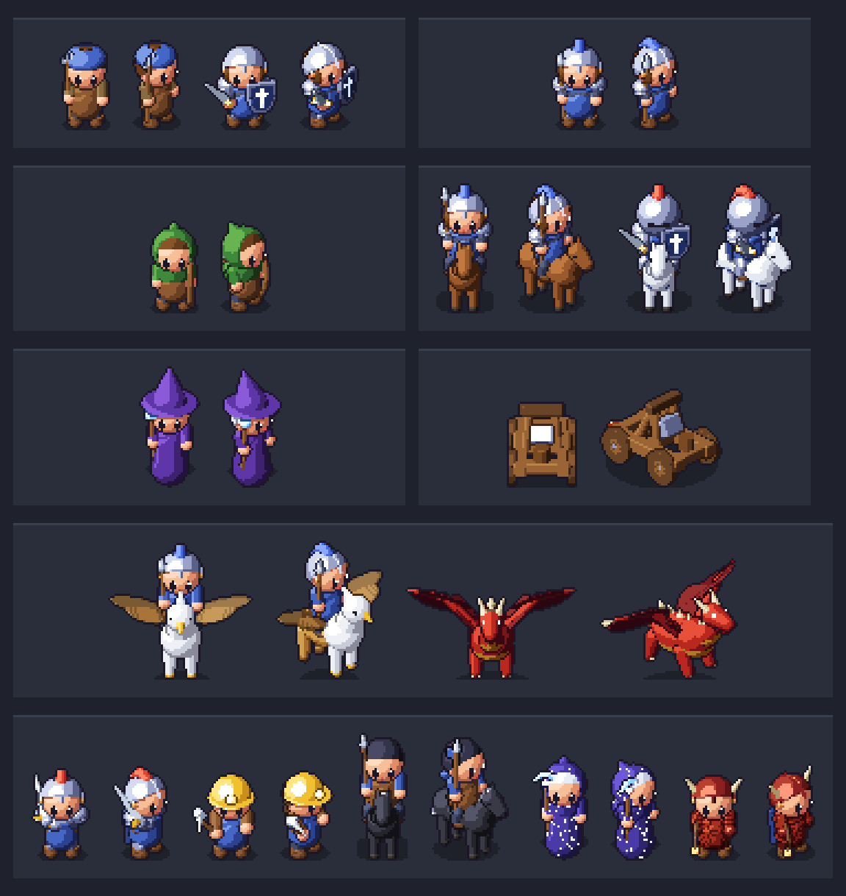

*Hàng 1: Dân quân, Kiếm sĩ | Lính giáo. Hàng 2: Cung thủ | Kỵ binh, Hiệp sĩ. Hàng 3: Pháp sư | Máy bắn đá lửa. Hàng 4: Sư thứu, Rồng. Hàng 5 (anh hùng): Thạch Lâm, Kim Hạ, Phong Vũ, Lam Nguyệt, Hỏa Kỳ. Mỗi quân hiện hai hướng: xuống (S) và chéo xuống phải (SE).*

## 14.1 Cách làm: dựng 3D rồi chiếu ra pixel

Vẽ tay 8 hướng × 5 hoạt ảnh × 15 quân là khoảng 3 500 khung hình, khó giữ cho các hướng khớp nhau. Cách làm ở đây:

1. Mỗi quân là một **búp bê 3D** ghép từ khối đơn giản (cầu, elip, ống thon, hộp bo góc). Ví dụ Kiếm sĩ gồm đầu, mắt, mũ, thân, váy áo, thắt lưng, hai tay, hai chân, ủng, kiếm, khiên, giáp vai: khoảng 30 khối.
2. Mỗi khung hình là một **tư thế**: góc chân, vị trí hai tay, hướng vũ khí, độ nghiêng người, độ nhún, độ dây cung…
3. **8 hướng = xoay cùng một mô hình** 45° một lần, nên hướng nào cũng đúng tỉ lệ, đúng tay cầm vũ khí (tay phải luôn cầm vũ khí, tay trái cầm khiên/cung).
4. Bộ vẽ bắn tia qua từng pixel (camera chếch 30°, 1,5 px cho mỗi đơn vị mô hình), tô **4 sắc độ** theo ánh sáng từ trên-trái-trước, thêm điểm bóng loáng cho kim loại, rồi kẻ **viền tối `#1B1726`** quanh hình và **viền trong** ở chỗ hai bộ phận chồng lên nhau (tay trước thân, khiên trước người).

```bash
node tools/unitgen/build.mjs     # ~25 giây: 3 454 khung → docs/design/assets/units/
```

| File | Nội dung |
|---|---|
| `tools/unitgen/sdf.mjs` | Bộ vẽ: khối 3D, chiếu, tô bóng, viền |
| `tools/unitgen/rig.mjs` | Khung người, ngựa, sư thứu, rồng, máy bắn đá, vũ khí |
| `tools/unitgen/units.mjs` | Danh sách quân, bảng màu, tư thế từng hoạt ảnh |
| `tools/unitgen/build.mjs` | Xuất sprite sheet, atlas, GIF, cảnh giao tranh, trang xem trước |
| `tools/unitgen/gif.mjs` | Bộ ghi GIF (không cần thư viện) |

**Xem tương tác:** mở [assets/units/xem-truoc.html](assets/units/xem-truoc.html) trong trình duyệt. Chọn quân, chọn hoạt ảnh, xem cả 8 hướng chạy cùng lúc, kéo thanh phóng to. Trang tự chứa ảnh nên mở offline được.

## 14.2 Phong cách (rút ra từ ảnh mẫu)

| Yếu tố | Quy ước |
|---|---|
| Tỉ lệ | Chibi: đầu chiếm ~45% chiều cao, mắt to 2×3 px có chấm sáng trắng, miệng 1 px |
| Chiều cao | Bộ binh ~40 px, kỵ binh ~60 px, Rồng ~110 px sải cánh |
| Viền | Viền ngoài `#1B1726` dày 1 px. Viền trong là sắc tối nhất của chính chất liệu |
| Ánh sáng | Từ trên-trái-trước, cố định theo thế giới (quân quay lưng thì lưng sáng bên trái) |
| Kim loại | Mũ, giáp, lưỡi kiếm có 1–3 pixel bóng trắng |
| Màu đội | Áo, khiên, áo choàng, cờ, mũ vải, áo giáp ngựa dùng **màu người chơi**. Ảnh chương này là đội lam, cảnh giao tranh có đội đỏ. Thay màu chỉ là đổi bảng 4 sắc |
| Phát sáng | Quả cầu phép, đèn mũ thợ mỏ, mắt rồng, lửa: không tô tối, luôn sáng |
| Bóng đổ | Elip đen mờ 30% dưới chân. Quân bay có bóng tách rời dưới đất |

## 14.3 Tám hướng

Thứ tự hướng trong mọi GIF và sprite sheet đi **theo chiều kim đồng hồ** bắt đầu từ hướng xuống (cùng chiều xếp đội hình):

| Hàng trên GIF | 1 | 2 | 3 | 4 |
|---|---|---|---|---|
| **Trên** | S: đi xuống / mặt trước | SW: chéo xuống trái | W: quay trái | NW: chéo lên trái |
| **Dưới** | N: quay lưng | NE: chéo lên phải | E: quay phải | SE: chéo xuống phải |

## 14.4 Hoạt ảnh

| Hoạt ảnh | Khung | Tốc độ | Nội dung |
|---|---|---|---|
| **Chờ** | 4 | 6 khung/giây, lặp | Thở (nhún 0,5 px), áo choàng lay, cầu phép nhấp nháy, cánh vỗ nhẹ, đuôi ngựa vẫy |
| **Đi** | 6 | 10 khung/giây, lặp | Bước chân luân phiên có nhấc gót, tay đánh ngược chân, người nghiêng tới. Ngựa chạy kiệu (chân chéo cặp), nhún. Cánh vỗ mạnh. Bánh xe máy bắn đá quay |
| **Đánh** (giao tranh) | 6 | 10 khung/giây | Chuẩn bị → vung/kéo → đỉnh → **trúng (khung 3)** → theo đà → về thế. Mỗi loại vũ khí một kiểu (bảng mục 14.5) |
| **Chiến thắng** | 6 | 8 khung/giây | Khuỵu lấy đà → **nhảy lên** giơ vũ khí lên trời (cung giơ cao, gậy phép sáng rực) → đáp. Kỵ: ngựa **chồm hai chân trước**. Rồng: ngẩng lên, dang cánh, gầm. Máy bắn đá: nảy lên, cờ màu đội phấp phới |
| **Chết** | 6 | 8 khung/giây | Khung 0 **lóe trắng** → ngã ngửa ra sau, tay buông ra hai bên → nằm yên (giữ khung cuối làm xác). Kỵ và quân bay đổ nghiêng sang bên. Rồng rơi xuống đất |

## 14.5 Giao tranh

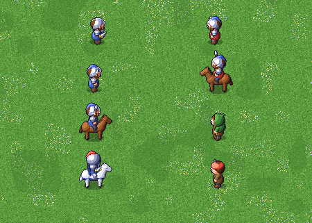

*Bốn cặp đánh tay đôi theo luật [08-chien-dau.md](08-chien-dau.md): đội lam bên trái, đội đỏ bên phải. Kiếm sĩ khắc Lính giáo, Lính giáo khắc Kỵ binh, Kỵ binh khắc Cung thủ, Hiệp sĩ đè Dân quân. Hai bên tiến lại, đánh lệch nhịp nhau, có tia lóe và số sát thương ở khung trúng. Bên bị khắc ngã xuống, bên thắng nhảy lên ăn mừng.*

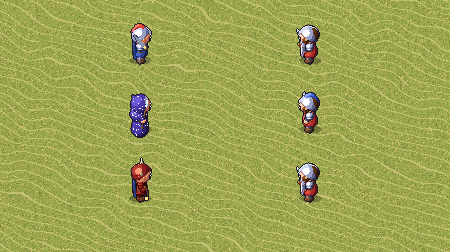

*Ba anh hùng đánh tay đôi: Thạch Lâm (đại kiếm), Lam Nguyệt (gậy trăng), Hỏa Kỳ (roi lửa).*

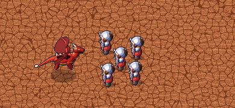

*Rồng lấy hơi rồi phun lửa vào một nhóm Kiếm sĩ đỏ. Lửa lan tới đâu quân ngã tới đó.*

## 14.6 Từng quân

### Dân quân

*Bộ binh.* Mũ vải màu đội, áo da nâu, ống tay vải thô, cầm chĩa ba. Không giáp, không khiên: nhìn là biết quân rẻ nhất.
**Đòn đánh:** Đâm chĩa thẳng (giống Lính giáo).

| Đi | Đánh | Chiến thắng |
|---|---|---|
| 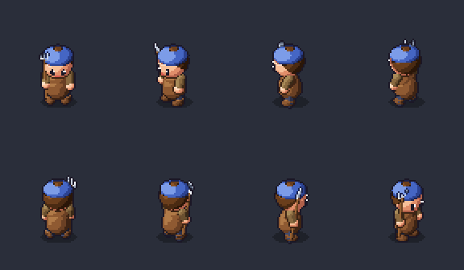 | 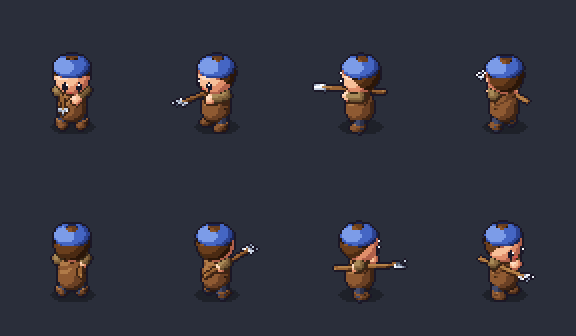 | 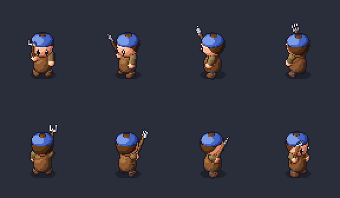 |

Thêm: [chờ](assets/units/gif/dan-quan-cho.gif) · [chết](assets/units/gif/dan-quan-chet.gif) · [sprite sheet](assets/units/sheets/dan-quan.png)

### Kiếm sĩ

*Bộ binh.* Mũ thép tròn có thanh che mũi, áo màu đội, giáp vai thép, khiên tròn màu đội có viền thép và chữ thập trắng, kiếm ngắn chuôi vàng.
**Đòn đánh:** Vung kiếm từ sau ra trước, khiên đưa lên che, bước chân phải tới.

| Đi | Đánh | Chiến thắng |
|---|---|---|
| 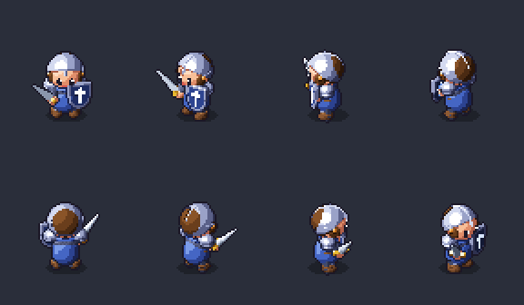 | 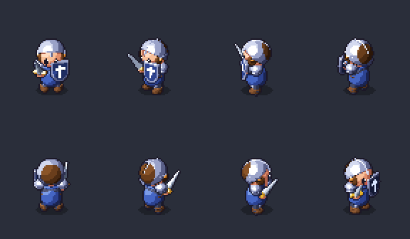 | 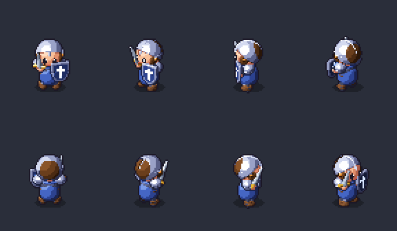 |

Thêm: [chờ](assets/units/gif/kiem-si-cho.gif) · [chết](assets/units/gif/kiem-si-chet.gif) · [sprite sheet](assets/units/sheets/kiem-si.png)

### Lính giáo

*Giáo.* Mũ thép có chỏm lông xanh, áo màu đội, giáp vai. Giáo dài gấp rưỡi người, cầm dựng đứng khi chờ.
**Đòn đánh:** Hạ giáo ngang, rút về rồi đâm thẳng bằng hai tay, người đổ tới.

| Đi | Đánh | Chiến thắng |
|---|---|---|
| 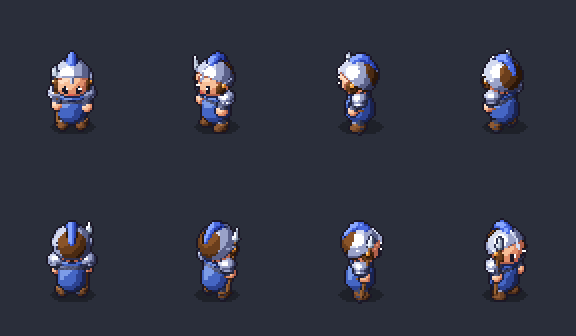 | 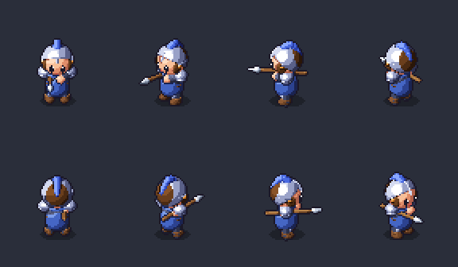 | 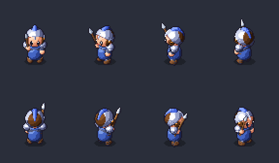 |

Thêm: [chờ](assets/units/gif/linh-giao-cho.gif) · [chết](assets/units/gif/linh-giao-chet.gif) · [sprite sheet](assets/units/sheets/linh-giao.png)

### Cung thủ

*Tầm xa.* Mũ trùm xanh lá có áo choàng vai, áo da, ống tên sau lưng có lông trắng, cung gỗ lớn.
**Đòn đánh:** Giương cung ngang vai, kéo dây về cằm (3 nấc), buông tên ở khung 3, hạ cung.

| Đi | Đánh | Chiến thắng |
|---|---|---|
| 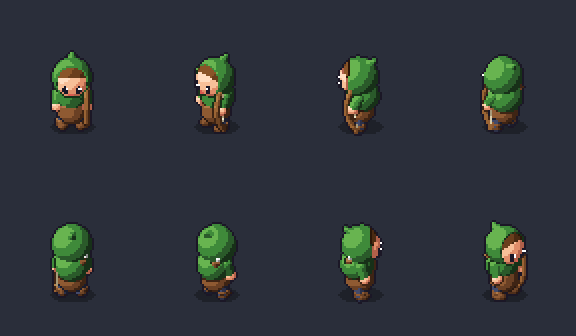 | 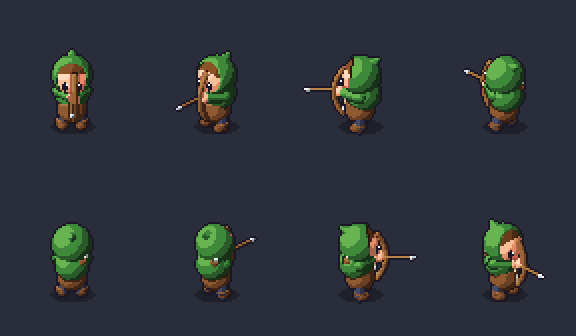 | 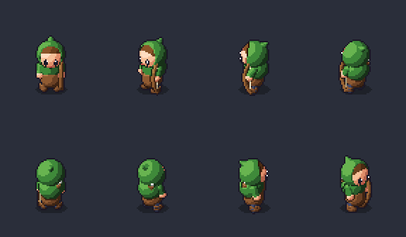 |

Thêm: [chờ](assets/units/gif/cung-thu-cho.gif) · [chết](assets/units/gif/cung-thu-chet.gif) · [sprite sheet](assets/units/sheets/cung-thu.png)

### Kỵ binh

*Kỵ.* Ngựa nâu bờm sẫm có yên da, người cưỡi mũ thép chỏm lông xanh, áo màu đội, thương dài dựng đứng khi chờ.
**Đòn đánh:** Hạ thương ngang, kéo về rồi đâm tới, ngựa nhổm chân trước ở khung trúng.

| Đi | Đánh | Chiến thắng |
|---|---|---|
| 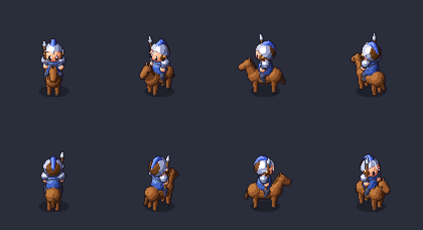 | 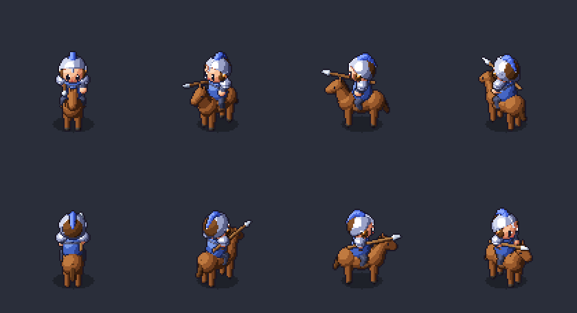 | 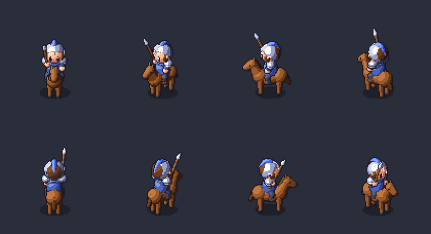 |

Thêm: [chờ](assets/units/gif/ky-binh-cho.gif) · [chết](assets/units/gif/ky-binh-chet.gif) · [sprite sheet](assets/units/sheets/ky-binh.png)

### Hiệp sĩ

*Kỵ.* Ngựa trắng phủ áo giáp vải màu đội viền vàng, người cưỡi giáp kín, mũ trụ kín có khe nhìn và chỏm lông đỏ, áo choàng, khiên tam giác viền vàng có chữ thập.
**Đòn đánh:** Chém kiếm từ trên lưng ngựa, khiên che phía trước.

| Đi | Đánh | Chiến thắng |
|---|---|---|
| 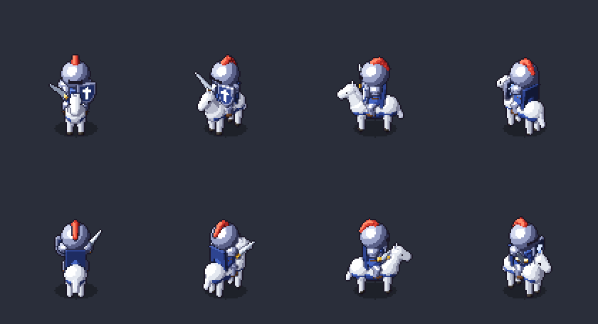 | 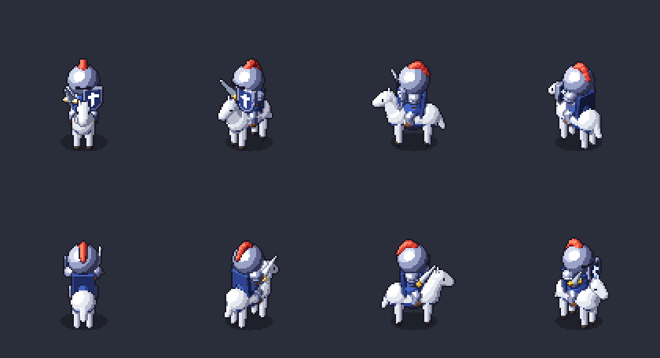 | 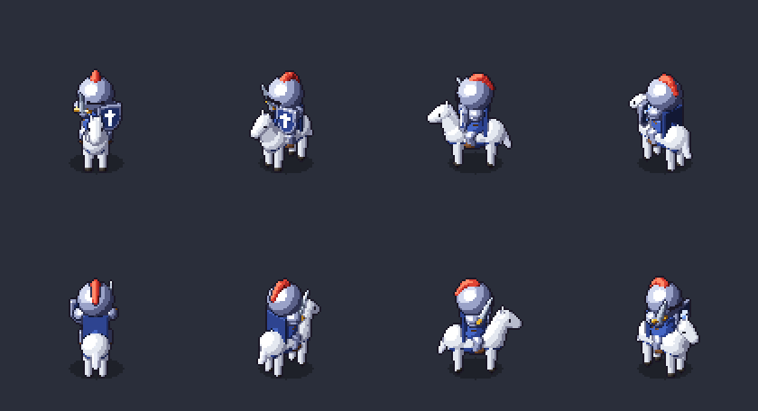 |

Thêm: [chờ](assets/units/gif/hiep-si-cho.gif) · [chết](assets/units/gif/hiep-si-chet.gif) · [sprite sheet](assets/units/sheets/hiep-si.png)

### Pháp sư

*Phép.* Mũ phù thủy tím chóp cao có dải vàng, tóc trắng, áo choàng dài tím phủ kín chân, gậy gỗ có quả cầu lam phát sáng và 3 vuốt vàng.
**Đòn đánh:** Giơ gậy lên, quả cầu sáng dần, chĩa gậy về phía trước ở khung trúng.

| Đi | Đánh | Chiến thắng |
|---|---|---|
| 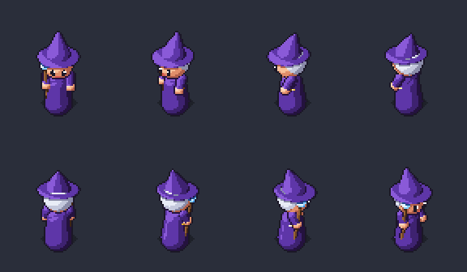 | 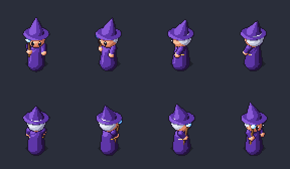 | 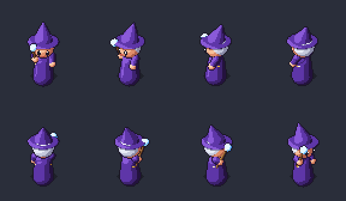 |

Thêm: [chờ](assets/units/gif/phap-su-cho.gif) · [chết](assets/units/gif/phap-su-chet.gif) · [sprite sheet](assets/units/sheets/phap-su.png)

### Máy bắn đá lửa

*Công thành.* Khung gỗ có 4 bánh xe nan (nan quay khi đi), giá chữ A, cần ném có gàu da, đối trọng sắt, thùng hắc ín phía trước, quả cầu lửa nằm trong gàu.
**Đòn đánh:** Kéo cần ra sau, bật cần qua đỉnh, quả cầu lửa bay ra ở khung 3, cần đập vào xà.

| Đi | Đánh | Chiến thắng |
|---|---|---|
| 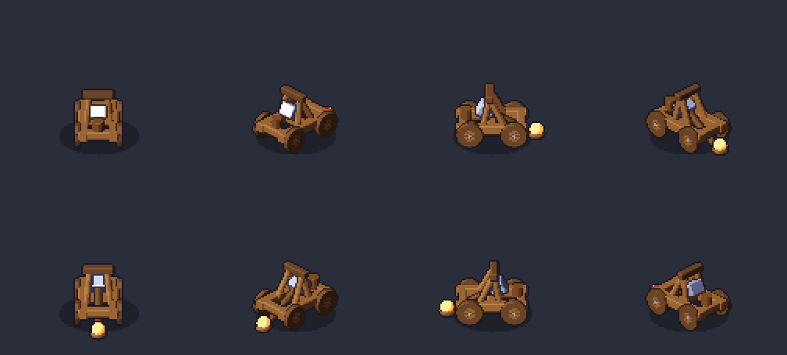 |  | 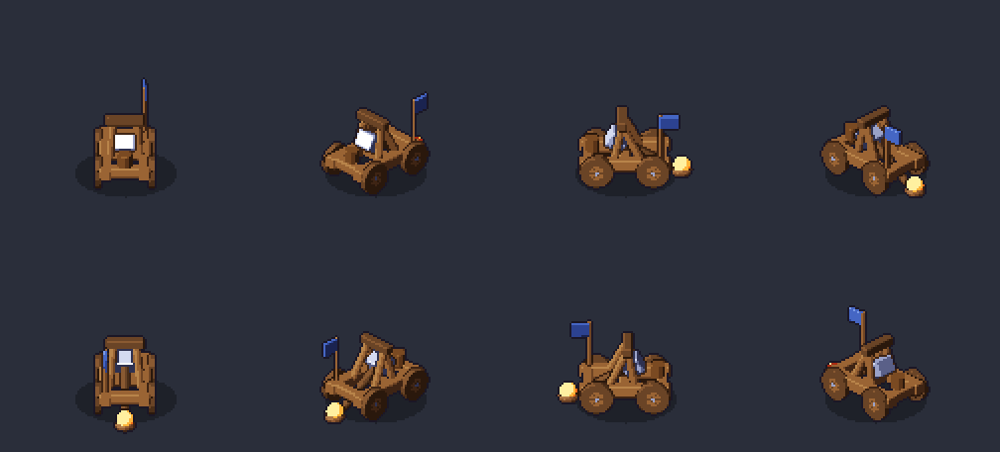 |

Thêm: [chờ](assets/units/gif/may-ban-da-cho.gif) · [chết](assets/units/gif/may-ban-da-chet.gif) · [sprite sheet](assets/units/sheets/may-ban-da.png)

### Sư thứu

*Bay.* Thân sư tử vàng nâu, đầu và ngực đại bàng trắng, mỏ vàng, đôi cánh nâu có đầu lông sẫm, bay cách đất. Người cưỡi mũ thép chỏm xanh cầm giáo.
**Đòn đánh:** Chúi người lao xuống, người cưỡi đâm giáo.

| Đi | Đánh | Chiến thắng |
|---|---|---|
| 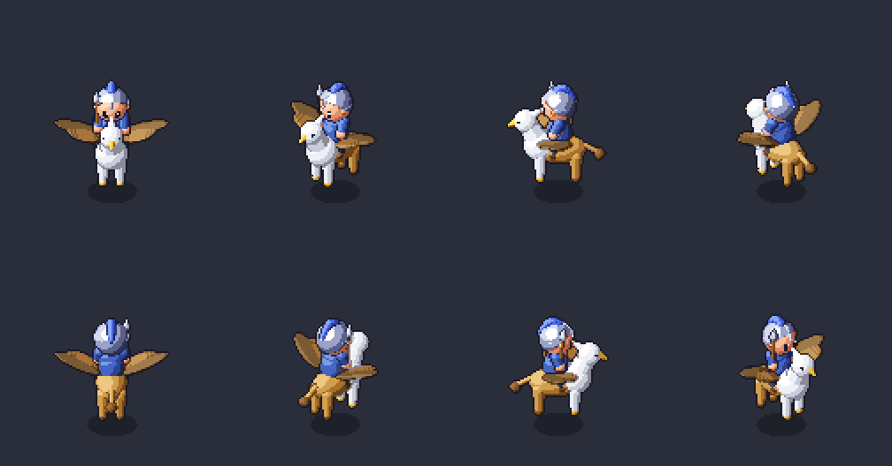 | 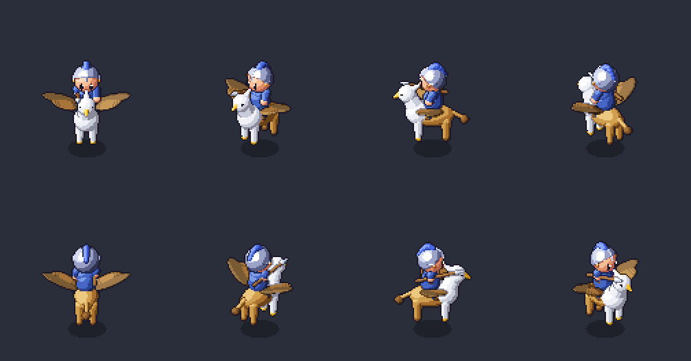 | 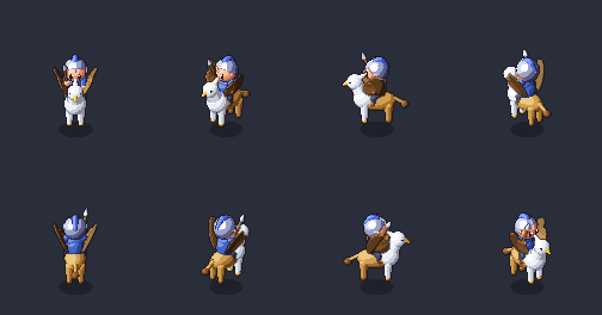 |

Thêm: [chờ](assets/units/gif/su-thuu-cho.gif) · [chết](assets/units/gif/su-thuu-chet.gif) · [sprite sheet](assets/units/sheets/su-thuu.png)

### Rồng

*Bay (huyền thoại).* Rồng đỏ thẫm, bụng vàng đồng, sừng và gai ngà dọc lưng, mắt vàng phát sáng, cánh màng đỏ sẫm, đuôi dài có mũi đuôi hình lá, bay cách đất.
**Đòn đánh:** Ngửa cổ lấy hơi (miệng sáng dần), vươn cổ phun lửa hình nón ở khung 3–4.

| Đi | Đánh | Chiến thắng |
|---|---|---|
| 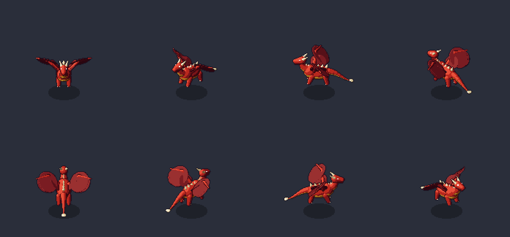 |  | 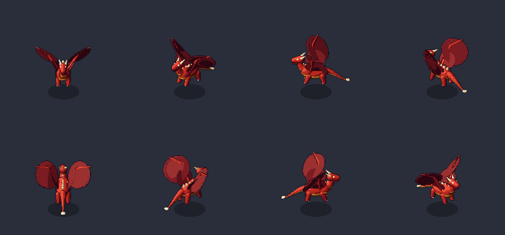 |

Thêm: [chờ](assets/units/gif/rong-cho.gif) · [chết](assets/units/gif/rong-chet.gif) · [sprite sheet](assets/units/sheets/rong.png)

### Thạch Lâm, Kiếm Vương

*Anh hùng.* Giáp thép toàn thân, găng thép, mũ thép chỏm lông đỏ, áo choàng màu đội, đại kiếm vác trên vai.
**Đòn đánh:** Vung đại kiếm bằng hai tay.

| Đi | Đánh | Chiến thắng |
|---|---|---|
| 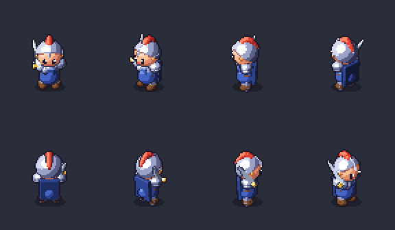 | 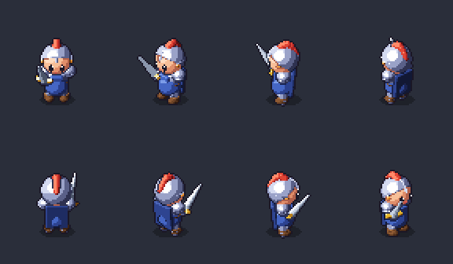 | 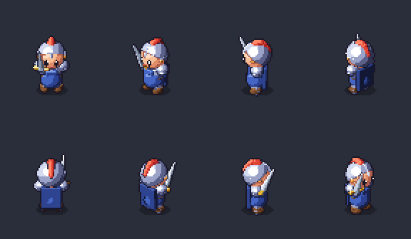 |

Thêm: [chờ](assets/units/gif/thach-lam-cho.gif) · [chết](assets/units/gif/thach-lam-chet.gif) · [sprite sheet](assets/units/sheets/thach-lam.png)

### Kim Hạ, Bà Chủ Mỏ

*Anh hùng.* Mũ thợ mỏ vàng bóng có đèn phát sáng, tóc nâu dài, áo yếm màu đội, tay áo da, búa chim.
**Đòn đánh:** Bổ búa chim từ trên xuống.

| Đi | Đánh | Chiến thắng |
|---|---|---|
| 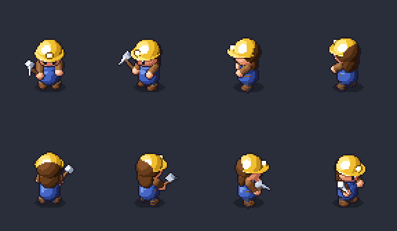 | 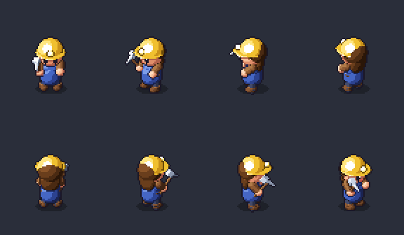 | 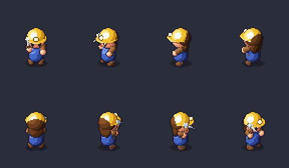 |

Thêm: [chờ](assets/units/gif/kim-ha-cho.gif) · [chết](assets/units/gif/kim-ha-chet.gif) · [sprite sheet](assets/units/sheets/kim-ha.png)

### Phong Vũ, Kỵ Tướng

*Anh hùng.* Ngựa ô bờm trắng, tóc đen, áo da, khăn quàng màu đội bay phía sau, thương có cờ đuôi nheo.
**Đòn đánh:** Đâm thương từ lưng ngựa.

| Đi | Đánh | Chiến thắng |
|---|---|---|
| 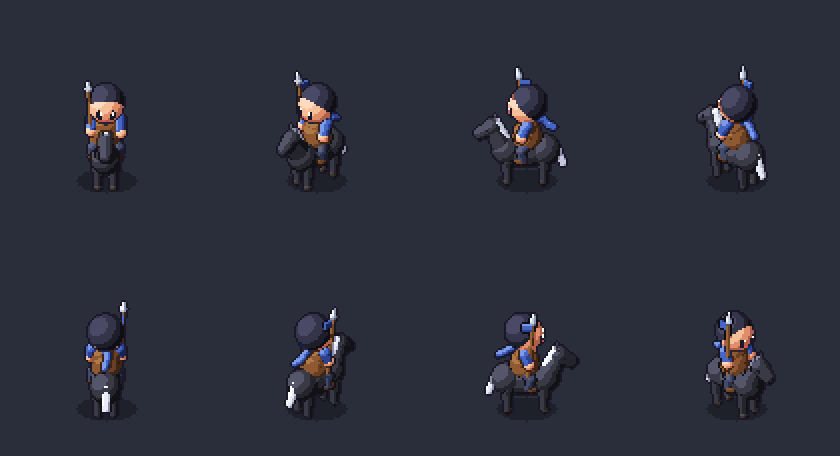 | 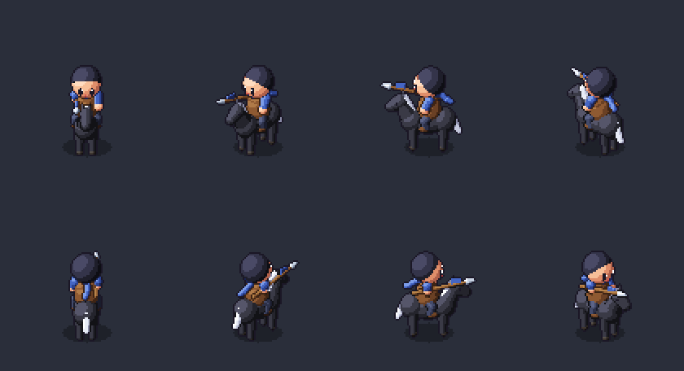 | 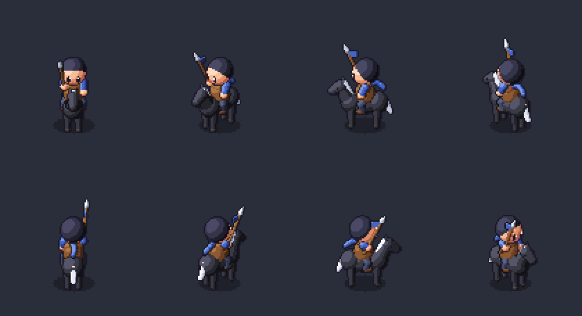 |

Thêm: [chờ](assets/units/gif/phong-vu-cho.gif) · [chết](assets/units/gif/phong-vu-chet.gif) · [sprite sheet](assets/units/sheets/phong-vu.png)

### Lam Nguyệt, Nữ Pháp Sư

*Anh hùng.* Mũ trùm và áo choàng tím than có chấm sao bạc, tóc trắng dài, gậy đầu trăng lưỡi liềm phát sáng.
**Đòn đánh:** Giơ gậy trăng, chĩa về phía trước.

| Đi | Đánh | Chiến thắng |
|---|---|---|
| 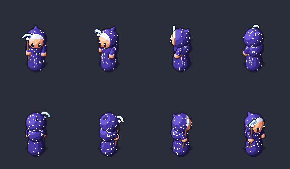 | 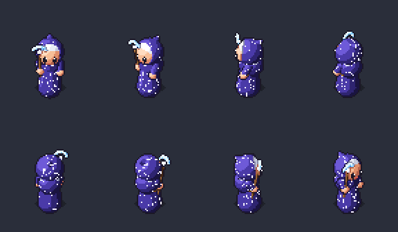 | 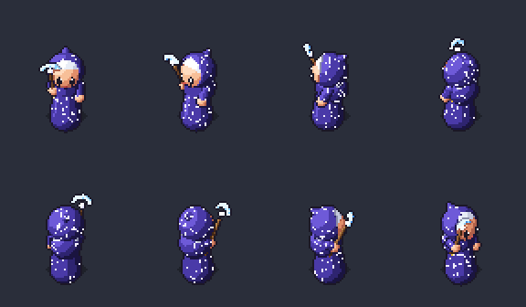 |

Thêm: [chờ](assets/units/gif/lam-nguyet-cho.gif) · [chết](assets/units/gif/lam-nguyet-chet.gif) · [sprite sheet](assets/units/sheets/lam-nguyet.png)

### Hỏa Kỳ, Kẻ Thuần Long

*Anh hùng.* Mũ đỏ sẫm có hai sừng ngà, giáp vảy đỏ, găng đỏ, áo choàng, roi da có đầu lửa.
**Đòn đánh:** Quất roi ra sau, vòng qua đầu, quất thẳng tới, đầu roi bùng lửa.

| Đi | Đánh | Chiến thắng |
|---|---|---|
| 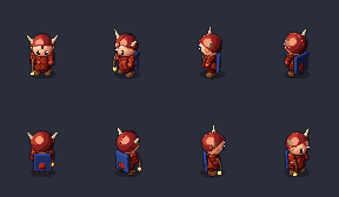 | 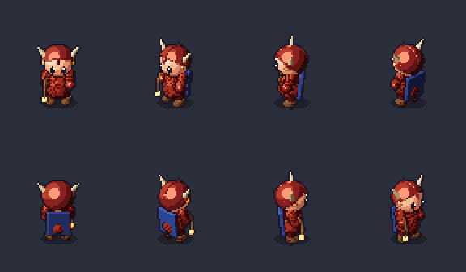 | 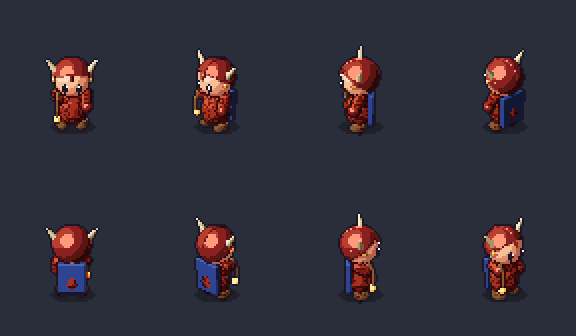 |

Thêm: [chờ](assets/units/gif/hoa-ky-cho.gif) · [chết](assets/units/gif/hoa-ky-chet.gif) · [sprite sheet](assets/units/sheets/hoa-ky.png)

## 14.7 Sprite sheet cho game

- Mỗi quân một file `assets/units/sheets/<id>.png`, nền trong suốt, kèm `atlas.json` chung.
- Bố cục: 6 cột khung. Hàng nhóm theo hoạt ảnh **chờ, đi, đánh, chiến thắng, chết**, mỗi hoạt ảnh 8 hàng theo thứ tự hướng ở mục 14.3.
- `atlas.json` ghi cho mỗi quân: kích thước khung, **điểm neo** (pixel chạm đất ở giữa chân), số khung, tốc độ, có lặp không, **khung trúng** của đòn đánh (server tính sát thương đúng lúc khung này hiện).

| Quân | Khung (px) | Điểm neo |
|---|---|---|
| Bộ binh, Cung thủ, Pháp sư, anh hùng đi bộ | 72 × 84 | (36, 63) |
| Kỵ binh, Hiệp sĩ, Phong Vũ | 105 × 114 | (53, 90) |
| Máy bắn đá lửa | 126 × 114 | (63, 87) |
| Sư thứu | 126 × 132 | (63, 108) |
| Rồng | 174 × 162 | (87, 126) |

Khung rộng hơn thân quân vì phải chừa chỗ cho giáo đâm, kiếm vung, cánh dang, lửa phun và lúc ngã ra. Khi vẽ thì đặt điểm neo trùng vị trí quân trên bản đồ, sắp thứ tự vẽ theo `y` của điểm neo.

**Lưu ý về tỉ lệ với ô bản đồ:** một ô là 16 px, bộ binh cao ~40 px (khoảng 2,5 ô) như các game nhập vai pixel nhìn chếch. Khoảng cách ô đội hình 1,5 ô (24 px) nên các hàng quân che nhau một phần, nhìn thành khối quân đông.

## 14.8 Thêm quân mới

Thêm một dòng vào `UNITS` trong `units.mjs` với trang bị có sẵn: mũ `kettle | nasal | greathelm | hood | wizard | cap | hardhat | horned`, thân `tunic | armor | robe | leather | scale | overall`, vũ khí `sword | greatsword | spear | lance | pitchfork | bow | staff | moonstaff | pick | whip`, khiên `round | heater`, thêm `cape`, `quiver`, `plume`, `scarf`, `longHair`, cưỡi `horse | griffin`. Chạy lại `build.mjs` là có đủ 8 hướng × 5 hoạt ảnh.

## 14.9 Sprite vẽ bằng AI (đang thay dần bộ quân dựng 3D)

Quân sẽ được vẽ bằng công cụ AI theo prompt trong [samples/army/prompts/README.md](samples/army/prompts.md), rồi đưa vào game bằng công cụ nhập:

```bash
node tools/spriteimport/import.mjs <sheet.png> <mã quân> [hàng=idle,walk,attack,hit,victory,death] [cao=46]
```

Công cụ làm các việc sau:
- Bỏ nền magenta và bóng tím dưới chân.
- Tìm hàng và cột theo các mảng hình.
- Đưa về lưới pixel gốc: tự đo tỉ lệ (khoảng 3 px ảnh cho mỗi pixel), dùng bảng 40 màu, viền tối được ưu tiên giữ lại.
- Canh chân về cùng một điểm neo.
- Xếp lại theo thứ tự hướng của game, tạo bản **đội đỏ** (chỉ đổi màu vải xanh, giữ thép).
- Xuất ra `assets/units-ai/`: sheet đội lam và đỏ, `atlas.json`, ảnh duyệt `<mã>-xem.png`, GIF.

Tách theo ranh giới cột: khi tia phép, lửa hay đạn bay nối liền hai ô cạnh nhau, công cụ cắt mảng hình tại ranh giới cột để mỗi ô giữ đúng con của mình. Nếu thừa hàng (ví dụ cột khói của máy bắn đá bị nhận thành một hàng riêng), hàng ít chi tiết nhất được gộp vào hàng gần nhất.

Anh hùng dùng cờ `--no-team`: giữ nguyên màu gốc, không tạo bản đội đỏ, vì màu là nhận diện của anh hùng (Lam Nguyệt xanh, Hỏa Kỳ đỏ…). Trong game, phe của anh hùng hiện bằng vòng màu dưới chân.

### Đã nhập (11/11/2026): đủ 15 quân

| Quân | Mã | Hàng | Cao (px) | Ô (px) | Đội đỏ |
|---|---|---|---|---|---|
| Dân quân | `dan-quan` | 7 (2 hàng chiến thắng) | 46 | 78 × 54 | có |
| Kiếm sĩ | `kiem-si` | 7 | 46 | 64 × 54 | có |
| Lính giáo | `linh-giao` | 7 | 46 | 78 × 54 | có |
| Cung thủ | `cung-thu` | 7 | 46 | 72 × 54 | có, nhưng áo xanh lá nên gần như không đổi |
| Pháp sư | `phap-su` | 7 | 46 | 100 × 54 | có |
| Kỵ binh (ngựa nâu, giáo) | `ky-binh` | 6 | 58 | 94 × 66 | có |
| Hiệp sĩ (cưỡi ngựa) | `hiep-si` | 6 | 58 | 68 × 73 | có |
| Máy bắn đá lửa | `may-ban-da` | 6 | 56 | 104 × 64 | có |
| Sư thứu | `su-thuu` | 6 | 66 | 116 × 82 | có |
| Rồng | `rong` | 6 | 80 | 144 × 100 | có (chỉ đổi yên xanh) |
| Thạch Lâm | `thach-lam` | 6 | 50 | 76 × 58 | không |
| Kim Hạ | `kim-ha` | 6 | 50 | 90 × 57 | không |
| Phong Vũ | `phong-vu` | 6 | 58 | 96 × 65 | không |
| Lam Nguyệt | `lam-nguyet` | 6 | 50 | 76 × 57 | không |
| Hỏa Kỳ | `hoa-ky` | 6 | 50 | 86 × 58 | không |

Lệnh nhập lại toàn bộ:

```bash
S=docs/design/samples/army/sprite-pixels; R6=idle,walk,attack,hit,victory,death; R7=idle,walk,attack,hit,victory,victory2,death
for u in dan-quan kiem-si linh-giao cung-thu phap-su; do node tools/spriteimport/import.mjs $S/$u.png $u $R7 46; done
for u in ky-binh hiep-si; do node tools/spriteimport/import.mjs $S/$u.png $u $R6 58; done
node tools/spriteimport/import.mjs $S/may-ban-da.png may-ban-da $R6 56
node tools/spriteimport/import.mjs $S/su-thuu.png su-thuu $R6 66
node tools/spriteimport/import.mjs $S/rong.png rong $R6 80
for h in thach-lam kim-ha lam-nguyet hoa-ky; do node tools/spriteimport/import.mjs $S/$h.png $h $R6 50 --no-team; done
node tools/spriteimport/import.mjs $S/phong-vu.png phong-vu $R6 58 --no-team
```

Điểm còn hạn chế của ảnh AI:
- Hướng chéo sau (cột 4 và 6) nhiều quân vẫn lộ mặt thay vì quay lưng.
- Mỗi hoạt ảnh mới có 1 tư thế (chưa phải nhiều khung). Cần làm bước 2 trong prompt để có chuyển động mượt.
- Pháp sư ở hàng tấn công còn dính một mẩu nhỏ quả cầu phép của ô bên cạnh. Trong game, đạn phép vẽ riêng nên không ảnh hưởng.

Kiếm sĩ cũ (`kiem-si-b`, từ `sprite-pixels/1.png`) vẫn giữ để so sánh.

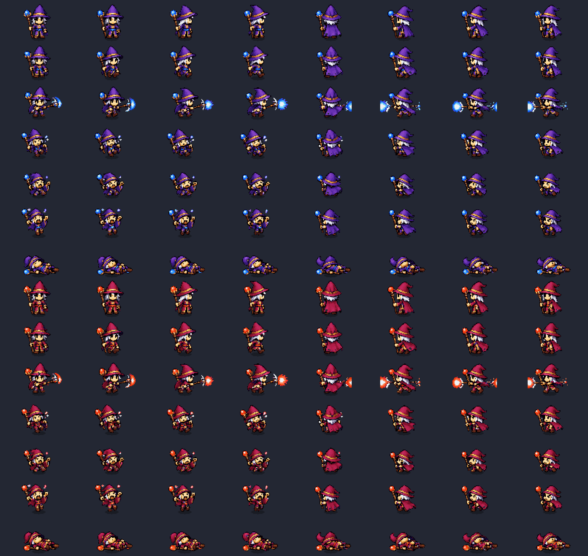

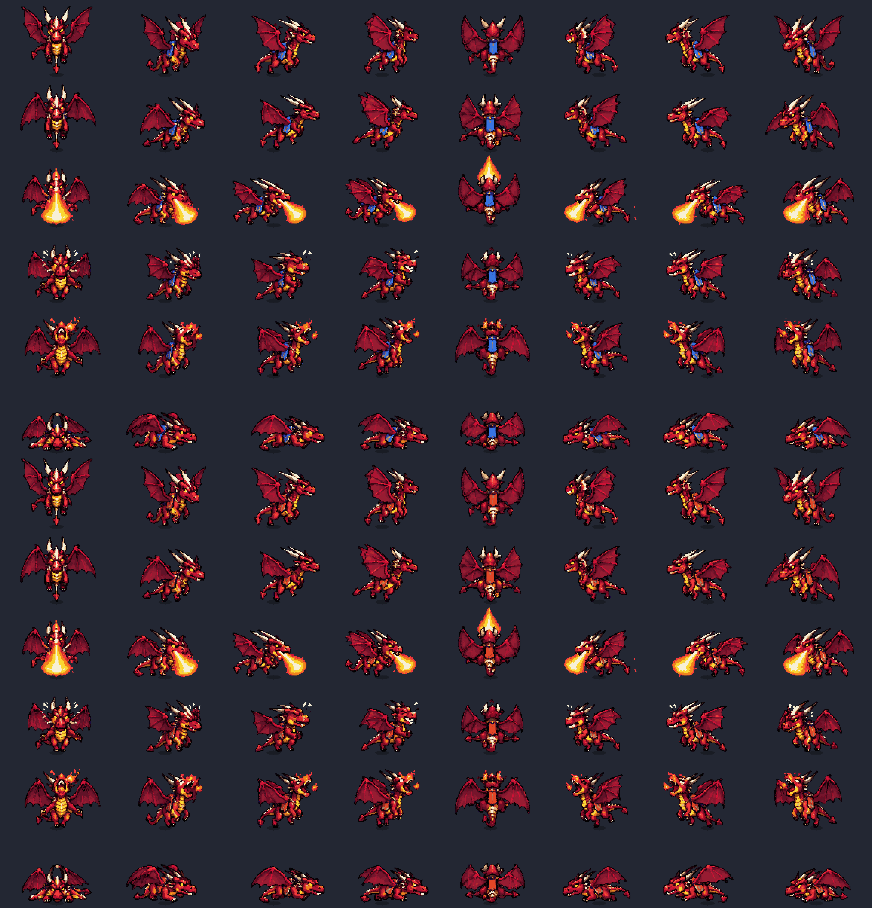
